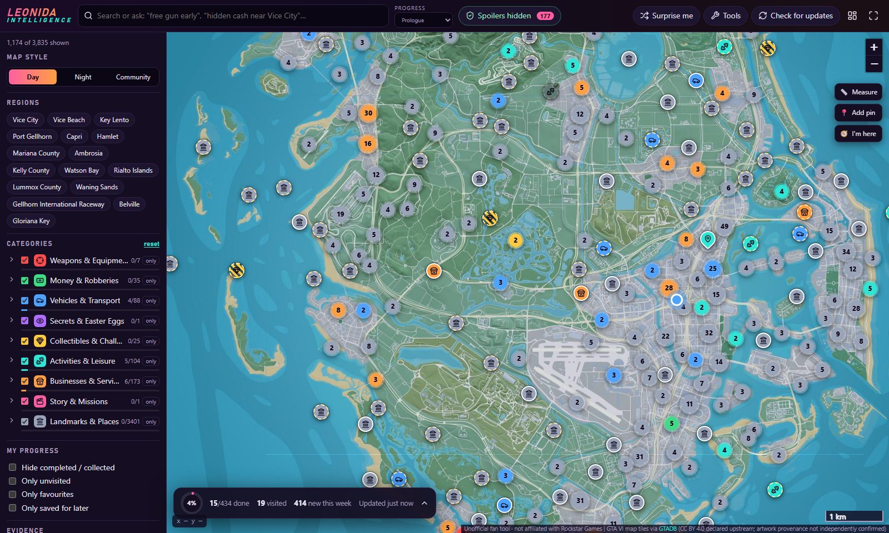
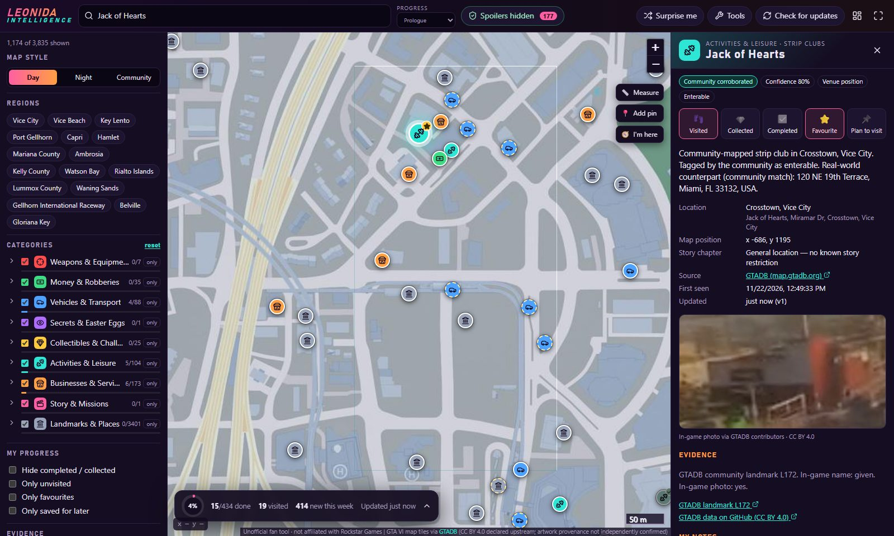
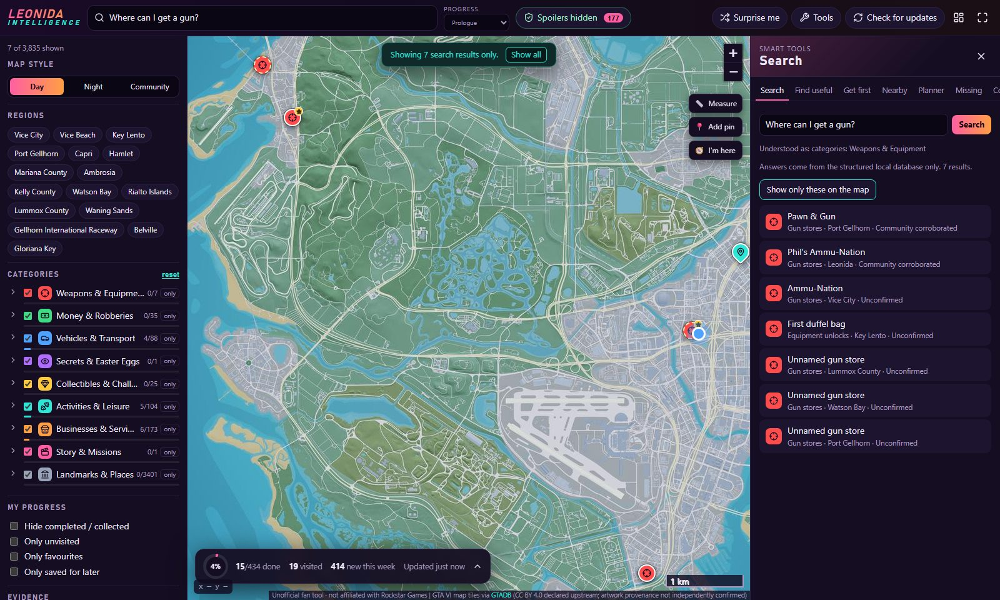
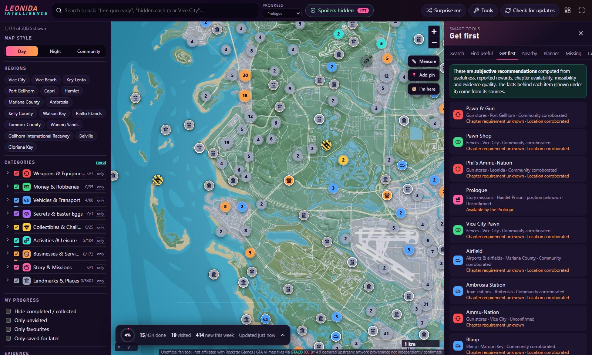
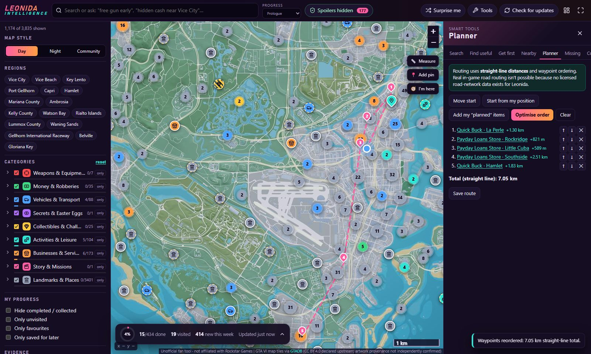
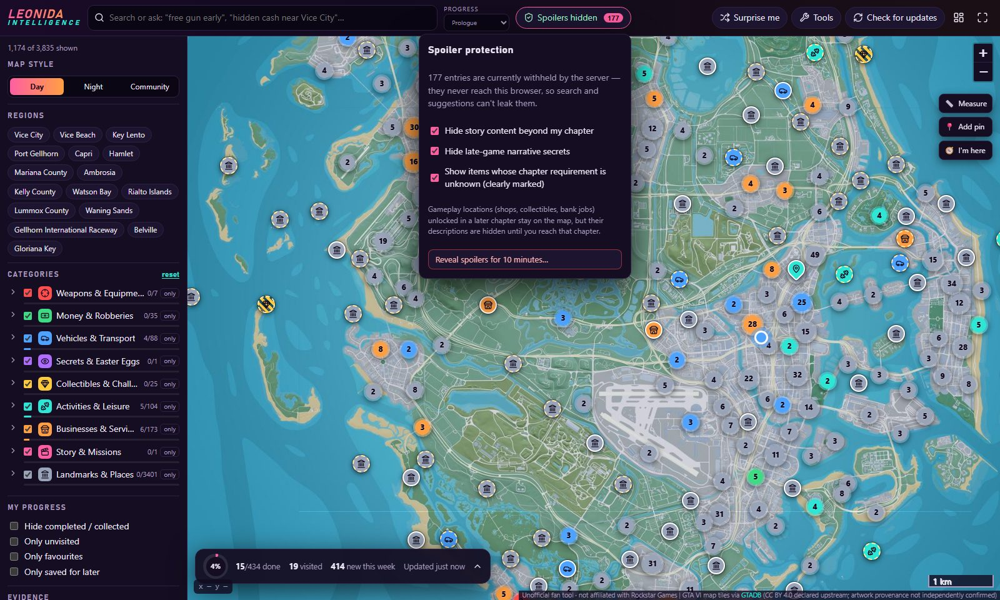
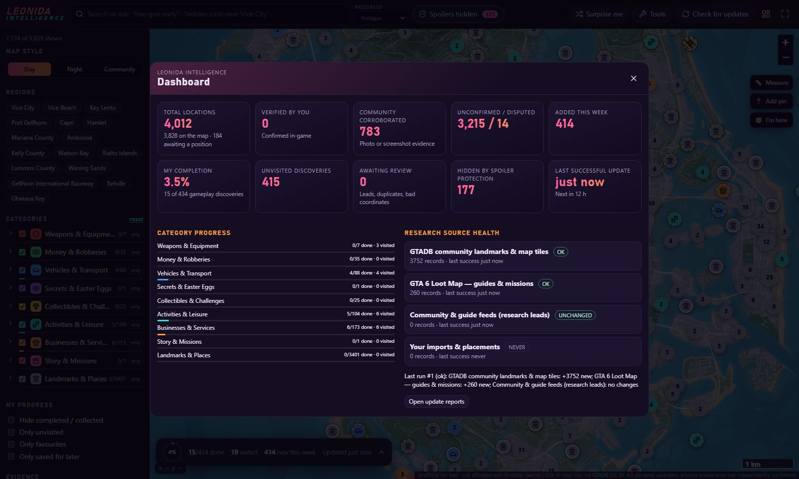
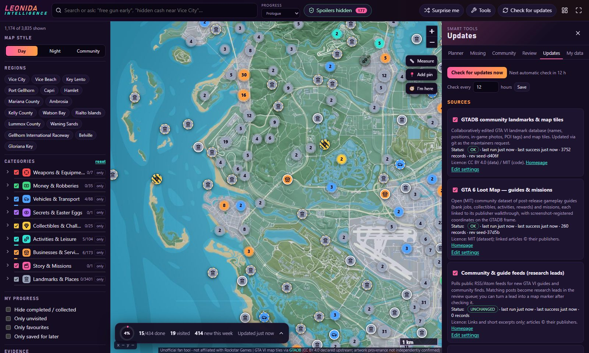
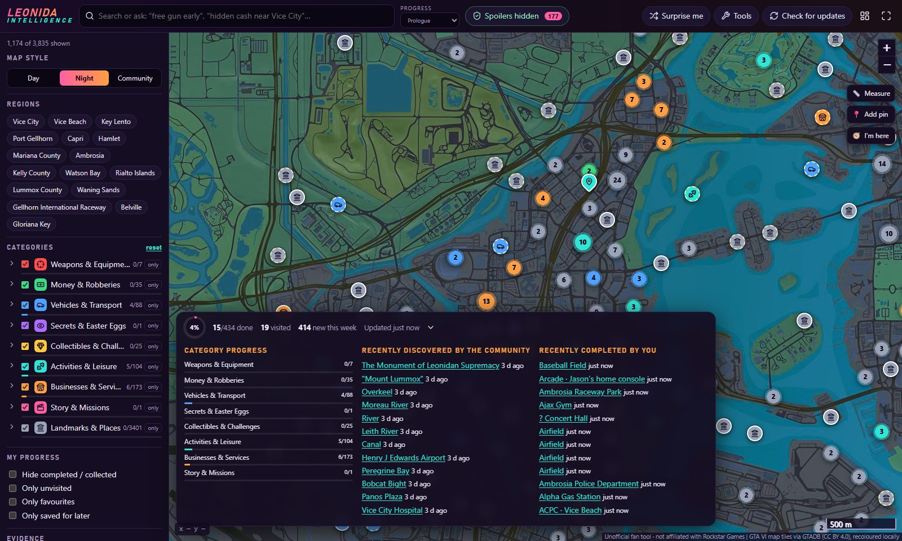
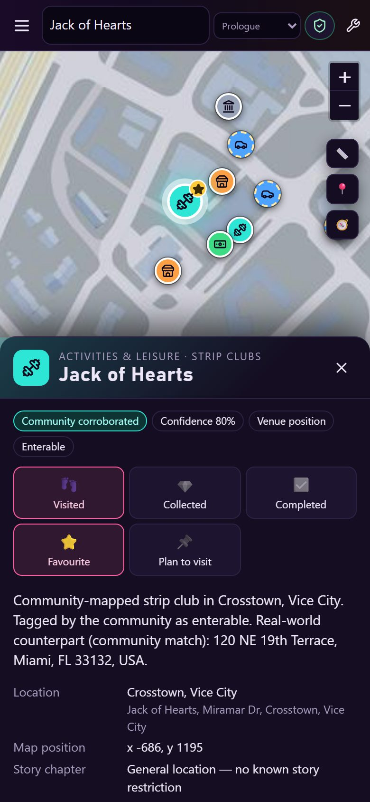

<div align="center">


# Leonida Intelligence

**A self-hosted GTA VI map and discovery companion for your home network.**

Open it on the PC, laptop, tablet or phone beside your PS5. Your progress follows you to every
device, and the map gains new places as the community discovers them.


[Quick start](#-quick-start) · [Features](#-features) · [Screenshots](#-screenshots) ·
[Documentation](#-documentation) · [Data & credits](#-data--credits)



</div>

> [!NOTE]
> This is an independent fan project for personal use. It is not affiliated with, endorsed by,
> or sponsored by Rockstar Games or Take-Two Interactive.

---

## ✨ Features

<table>
<tr>
<td width="50%" valign="top">

### 🗺️ The real map of Leonida
- In-game map tiles with smooth zoom, plus **Day**, **Night** and **Community** styles
- About **4,000 sourced places**, each linked to where it came from
- Category pins and clusters, region shortcuts, measuring tool, your own pins
- Remembers where you left off

</td>
<td width="50%" valign="top">

### ✅ Your progress, on every device
- Mark places **visited, collected, completed, favourite, planned**
- Notes, checklists, saved routes, completion stats
- Stored on your host computer, not in the browser
- Daily automatic backups, plus export and restore

</td>
</tr>
<tr>
<td valign="top">

### 🔎 Ask it questions
- *"Show me hidden cash near Vice City"*
- *"What secrets haven't I discovered?"*
- Runs offline on your own data; no AI subscription needed
- Tools: **What should I get first?**, **Nearby**, **Route planner**, **What am I missing?**,
  **Surprise me**

</td>
<td valign="top">

### 🛡️ Spoiler-safe and self-updating
- Set your chapter; future story content is **never sent to the browser**
- Checks approved sources every 12 hours (adjustable), or when you click
  **Check for updates**
- Every pin shows its evidence and verification status
- Never places a pin at a guessed position

</td>
</tr>
</table>

---

## 🚀 Quick start

**Windows 11.** You need [Node.js 24+](https://nodejs.org) and [git](https://git-scm.com).
If you don't have them:

```powershell
winget install OpenJS.NodeJS
```

```powershell
winget install Git.Git
```

Then, from the project folder:

```powershell
powershell -ExecutionPolicy Bypass -File .\setup.ps1
```

```powershell
.\start.cmd
```

Open **http://localhost:5180**. On your other devices, use `http://<this-PC's-IP>:5180`;
run `ipconfig` and look for *IPv4 Address*.

**Linux / Docker**

```sh
docker compose up -d
```

For autostart, firewall, Linux/systemd, configuration and security, see the
[**installation guide**](docs/installation.md).

---

## 📸 Screenshots

<table>
<tr>
<td width="50%"><br/><b>Location details.</b> Description, in-game photo, evidence, source links, progress toggles and notes.</td>
<td width="50%"><br/><b>Ask a question.</b> See how it was understood, then show only the results on the map.</td>
</tr>
<tr>
<td><br/><b>What should I get first?</b> Suggestions are labelled as opinions, with the facts underneath.</td>
<td><br/><b>Discovery planner.</b> Optimised waypoint order with honest straight-line distances.</td>
</tr>
<tr>
<td><br/><b>Spoiler protection.</b> Withheld on the server, with a confirm-to-reveal timer.</td>
<td><br/><b>Dashboard.</b> Totals, completion, items awaiting review and source health.</td>
</tr>
<tr>
<td><br/><b>Research updates.</b> Per-source status, licences, schedule and reports.</td>
<td><br/><b>Night style.</b> Category progress, recent community finds and your recent completions.</td>
</tr>
</table>

<p align="center"><br/><b>Works on phones and tablets too.</b></p>

---

## 📚 Documentation

| Guide | What's inside |
| --- | --- |
| [**Installation & hosting**](docs/installation.md) | Windows setup, opening it on other devices, autostart, Docker, systemd, configuration, security |
| [**User guide**](docs/user-guide.md) | The screen layout, pin styles, progress tracking, search, smart tools, spoilers, trust levels, backups, shortcuts |
| [**Research & updates**](docs/research-updates.md) | Where the data comes from, what each update does, schedule, managing sources, review queue, imports, rollback |
| [**Troubleshooting**](docs/troubleshooting.md) | Can't connect from another device, empty map, failed updates, missing progress |
| [**Architecture & development**](docs/architecture.md) | How it's built, project layout, running tests, regenerating screenshots |
| [**Source research**](docs/research.md) | Which sites were evaluated, their licences and terms, and why each was used or not |
| [**Status & roadmap**](docs/status.md) | What's tested, what isn't yet, and known data gaps |

---

## 🙏 Data & credits

| Data | Source | Licence |
| --- | --- | --- |
| Landmarks & map tiles | [GTADB](https://map.gtadb.org) — gtadb.org and all contributors (community cartography by YANIS and the GTA VI Mapping Community) | CC BY 4.0 |
| Gameplay guides & missions | [GTA 6 Loot Map](https://github.com/theihtishaam/GTA-6-Interactive-Map-and-Loot-Tracker) dataset, linking to original publisher articles such as PowerPyx and GamesRadar+ | MIT |
| Research leads | Public RSS/Atom feeds; only links and short excerpts are stored | Publishers' own |

- Map tiles are downloaded by each user's own setup and are **not** included in this
  repository.
- Full notices, including the changes made to the data, are in [ATTRIBUTION.md](ATTRIBUTION.md).
- The project's own code is [MIT-licensed](LICENSE).

*Grand Theft Auto*, *GTA VI*, *Leonida* and *Vice City* are trademarks of Rockstar Games /
Take-Two Interactive.
