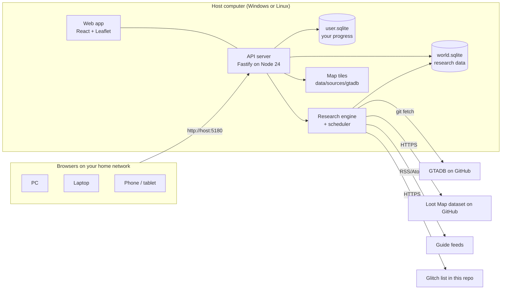

# Architecture & development

[← Back to README](../README.md)

## Overview



The **research data** and **your progress** are two separate SQLite files. The research engine
only writes to `world.sqlite`, so an update can never overwrite your progress.

## Project layout

```text
server/        Fastify API (TypeScript, run natively by Node 24 — no build step)
  app.ts         routes, LAN/CSRF/PIN guard, static files and map tiles
  db.ts          two SQLite databases (built-in node:sqlite) + versioned migrations
  worldRepo.ts   research data: locations, history, review queue, update runs, sources
  userRepo.ts    personal data: progress, markers, checklists, routes, settings, your verdicts
  backup.ts      progress backups, research snapshots, restore/rollback
  scheduler.ts   interval updates + daily backups
  worldView.ts   spoiler filtering/redaction, your overrides, regions, map layers
  ingest/        research engine and source adapters
    engine.ts      run orchestration, validation, merge, report
    gtadb.ts       GTADB adapter (git → GitHub HTTP → seed)
    lootmap.ts     GTA 6 Loot Map adapter
    glitches.ts    curated glitches, bug fixes and patch notes (seed/glitches)
    rss.ts         RSS/Atom research leads
    manualImport.ts, dedupe.ts, http.ts (polite fetch with backoff)
shared/        types, categories, coordinate frame, spoiler rules, search, routing
web/           React + Vite front end (Leaflet with a custom CRS)
seed/          pinned upstream data so the first start works offline
scripts/       map download, CLI backup, test server, screenshot generator, icon generator
installer/     Windows installer: Inno Setup script, C# tray launcher, build script, network helper
tests/unit     node:test unit + integration tests
tests/e2e      Playwright browser tests
docs/          documentation and screenshots
```

## Key design decisions

- **Leaflet with a custom CRS instead of MapLibre.** Leonida uses a flat, fictional coordinate
  frame. `CRS.Simple` with `Transformation(1/32, 512, −1/32, 512)` reproduces GTADB's tile
  pyramid exactly: zoom 0 is 32 m/px, zoom 5 is 1 m/px, and tiles are 256 px centred on (0, 0).
  This means coordinates need no fitting, and a test checks pin alignment against GTADB.
- **`node:sqlite` instead of better-sqlite3.** It needs no native compilation, so installing on
  Windows is a plain `npm install`.
- **TypeScript run natively in Node 24.** The server has no build step.
- **Spoiler filtering happens on the server.** Hidden records never reach the browser.
- **No AGPL code.** The AGPL-licensed *Leonida Atlas* was evaluated but not used; it gets its
  data from GTADB, which this project uses directly.

## Development

```powershell
npm run dev:server     # API with auto-reload on :5180
```

```powershell
npm run dev:web        # Vite dev server on :5173, proxying /api and /tiles
```

```powershell
npm run typecheck
```

## Tests

```powershell
npm test               # 31 unit + integration tests (node:test)
```

```powershell
npx playwright install chromium   # first time only
```

```powershell
npm run test:e2e       # 11 browser tests against an isolated server with seed data
```

The browser tests start their own server on port 5199, with a fresh data folder in
`test-results/`. They never touch your real `data/` folder.

## Regenerating screenshots

```powershell
node --disable-warning=ExperimentalWarning scripts/screenshots.ts
```

The script starts an isolated server, adds some demo progress and writes
`docs/screenshots/*.jpg`. The story stays at the Prologue so the images contain no spoilers.
