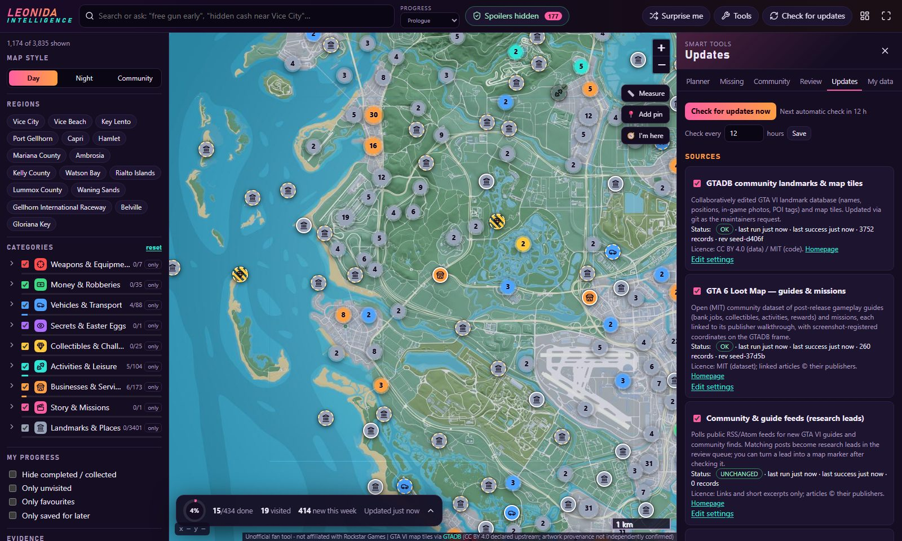

# Research & updates

[← Back to README](../README.md)

**On this page:**
- [Sources](#sources)
- [What happens on every run](#what-happens-on-every-run)
- [Schedule](#schedule)
- [Managing sources](#managing-sources)
- [Reviewing leads and uncertain data](#reviewing-leads-and-uncertain-data)
- [Importing your own data](#importing-your-own-data)
- [Recovering from a bad update](#recovering-from-a-bad-update)



Leonida Intelligence fills in more of the map as the community documents the game. Each source
runs in its own adapter, so a broken or changed source never stops the others.

## Sources

| Source | How it's fetched | What it adds | Licence |
| --- | --- | --- | --- |
| **GTADB** (map.gtadb.org) | `git fetch` of a sparse checkout, which is what the maintainers ask for. Falls back to the GitHub API and raw file, then to a pinned copy in `seed/` | About 3,750 landmarks with in-game names, photos and tags (gun stores, mod shops, safehouses, marinas, airports…), plus the map tiles | CC BY 4.0 (data) |
| **GTA 6 Loot Map** dataset (GitHub) | GitHub commit check, then the raw files at that commit. Falls back to a cached copy, then to the seed copy | Bank jobs, payday loans, vaults, collectibles, meditations, race trials, activities, rewards, and 176 missions with their chapters. Positions are taken from publishers' in-game map screenshots | MIT; each record links to its publisher's article |
| **Guide & community feeds** (RSS/Atom) | Conditional GET (ETag / Last-Modified), at most one request per site every 1.5 seconds | **Research leads only.** These go to the review queue and are never placed on the map automatically | Only links and short excerpts are stored |
| **Your imports** | **Tools → My data → Import** | Your own GeoJSON, JSON or CSV | Yours |

Why other sites aren't used is explained in [Source research](research.md). In short, either
their terms forbid automated collection, or they need a paid key whose reuse terms are unclear.

## What happens on every run

1. **Snapshot.** The research database is copied to `data/snapshots/` so the run can be undone.
2. **Fetch.** Each enabled source runs with a timeout. If upstream hasn't changed, nothing is
   rewritten.
3. **Validate.**
   - Coordinates outside Leonida are rejected and queued for review. Nothing is ever placed at
     a guessed position.
   - Duplicate keys in a source's output are rejected.
4. **Merge.** Each record has a stable ID and a content hash.
   - New records are inserted.
   - Changed records get a new version and an entry in their history.
   - Your progress is untouched; it lives in a separate database.
5. **Removals.** Records that disappear upstream are marked *outdated*, never deleted. If more
   than half of a source suddenly vanishes, removal is skipped. That usually means the upstream
   format changed.
6. **Queue.** Leads, possible duplicates and invalid coordinates go to the review queue.
7. **Report.** The report shows what was added, changed, removed, queued, rejected and failed
   for each source. You can read it in **Tools → Updates** and in the Dashboard.

## Schedule

- By default the app checks every **12 hours**. To change this, go to **Tools → Updates → Check
  every N hours**, or set `LI_UPDATE_INTERVAL_HOURS` in `.env`.
- The schedule counts the time since the last run, so it survives restarts and a sleeping PC.
- **Check for updates** in the top bar runs a check immediately.

## Managing sources

In **Tools → Updates**, each source shows:

- an on/off switch
- its last status and any error
- its last successful run, record count and data revision
- its licence
- an **Edit settings** link, which opens the source's settings as JSON

For example, the feeds source looks like this:

```json
{
  "feeds": [
    { "id": "powerpyx", "label": "PowerPyx (guides)", "url": "https://www.powerpyx.com/feed/", "enabled": true, "filter": "gta 6|gta vi|gta6" },
    { "id": "reddit-gta6", "label": "Reddit r/GTA6 (new posts)", "url": "https://www.reddit.com/r/GTA6/new/.rss", "enabled": false, "filter": "location|where|found|hidden|secret" }
  ]
}
```

Reddit is switched off by default because it rate-limits anonymous feed readers.

## Reviewing leads and uncertain data

Open **Tools → Review**. You'll find:

- **Research leads:** new guide posts and community finds. Open the source to read it, then
  either **Place on map…** at the position the source describes, **Dismiss** it or **Reject** it.
  A place you add this way is marked *unconfirmed* and keeps the source link.
- **Possible duplicates and bad coordinates** from imports or updates.
- **Unplaced items:** sourced discoveries whose position hasn't been published yet.

## Importing your own data

Go to **Tools → My data → Import locations**. You can paste text or load a file in any of these
formats:

- **GeoJSON:** a FeatureCollection of Point features.
- **JSON:** an array of objects.
- **CSV:** with columns `name, category, x, y, description, source_url`.

Coordinates must be either GTADB game units (x east, y north — hover over the map to see them)
or the normalised 0–1 frame.

What happens to each row:

- Valid rows are added to the map as *unconfirmed*.
- Rows that look like duplicates of existing places, or have no valid coordinates, go to review.

## Recovering from a bad update

**Tools → My data → Server backups & research snapshots → roll back** restores the research
database as it was before that update. Your progress is not affected.

For failures and error messages, see [troubleshooting](troubleshooting.md#an-update-failed).
