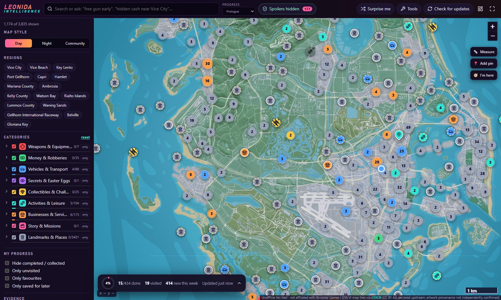
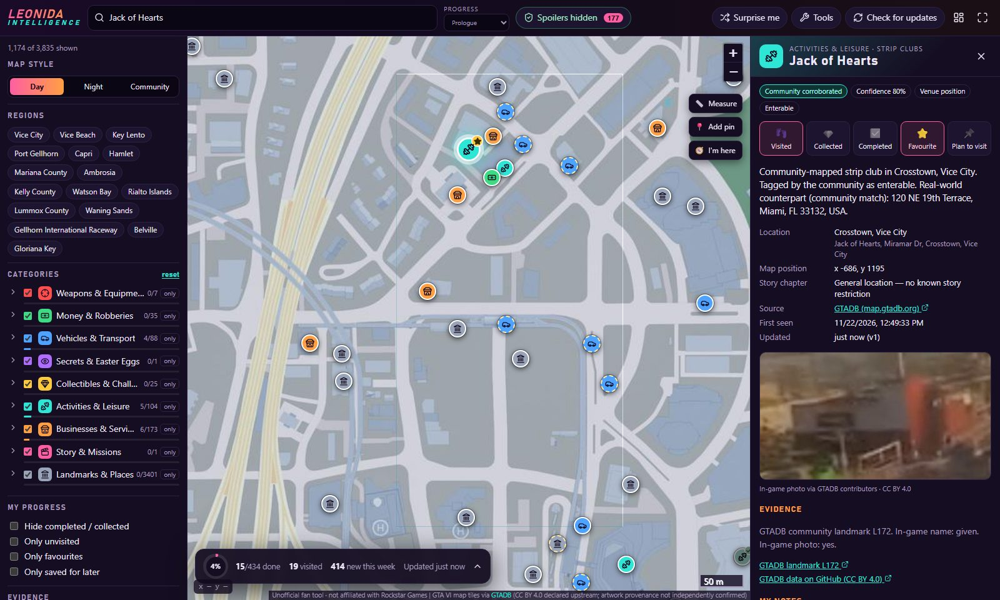
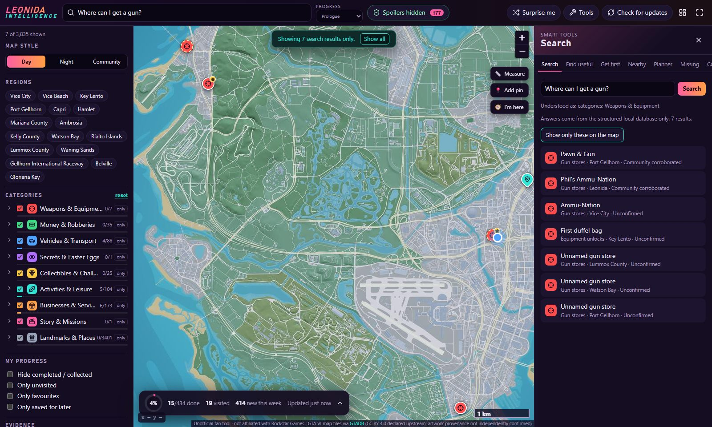
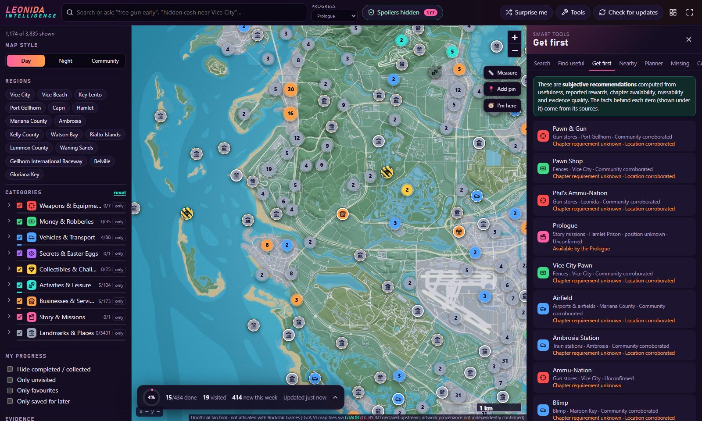
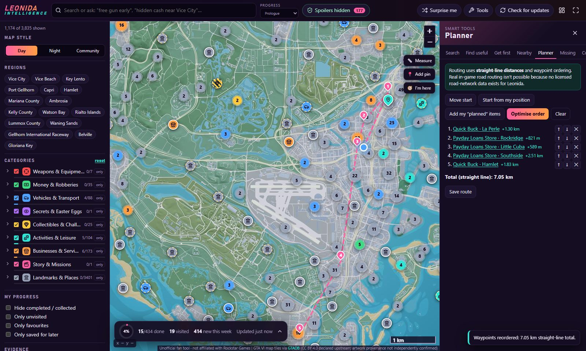
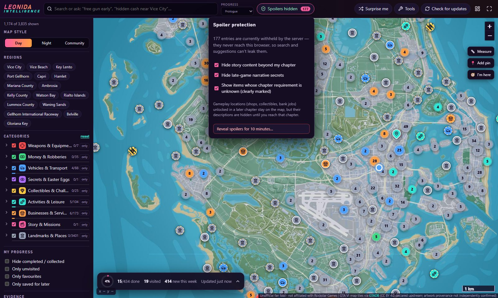

# User guide

[← Back to README](../README.md)

**On this page:**
- [The screen at a glance](#the-screen-at-a-glance)
- [Reading the map](#reading-the-map)
- [Tracking your progress](#tracking-your-progress)
- [Asking questions](#asking-questions)
- [Smart tools](#smart-tools)
- [Spoiler protection](#spoiler-protection)
- [How much to trust a pin](#how-much-to-trust-a-pin)
- [Backups](#backups)
- [Keyboard shortcuts](#keyboard-shortcuts)

---

## The screen at a glance



| Area | What's there |
| --- | --- |
| **Top bar** | Search box (also takes questions), your story **Progress** chapter, spoiler shield, *Surprise me*, *Tools*, *Check for updates*, Dashboard, Full screen |
| **Left panel** | Map style (Day / Night / Community), region shortcuts, categories with your progress, progress filters, evidence filters, legend |
| **Map** | Click any pin for details. The game coordinates under your cursor are shown bottom-left. Buttons on the right: **Measure**, **Add pin**, **I'm here** |
| **Right panel** | Details of the selected place, or the smart tools |
| **Bottom bar** | Your completion ring. Click it for per-category progress, places recently found by the community, and places you recently completed |

On a phone, the left panel moves behind the ☰ button and details open as a bottom sheet.

## Reading the map

Pins are coloured and iconed by category:

| Category | Colour |
| --- | --- |
| Weapons & Equipment | red |
| Money & Robberies | green |
| Vehicles & Transport | blue |
| Secrets & Easter Eggs | purple |
| Collectibles & Challenges | gold |
| Activities & Leisure | teal |
| Businesses & Services | orange |
| Story & Missions | pink |
| Landmarks & Places | grey |

The pin's style tells you how much to trust it:

| Pin style | Meaning |
| --- | --- |
| Solid white ring | Verified or community corroborated |
| Dashed ring | Unconfirmed, disputed or outdated |
| Faded | The position marks an approximate area, not an exact spot |
| Dimmed with ✓ | You've completed or collected it |
| ★ / small teal dot | Your favourite / saved for later |
| Striped | Unlocks in a later chapter; its details are hidden by spoiler protection |

Expand a category in the left panel to toggle its subcategories, or press **only** to show just
that category. "Unnamed buildings" (about 2,300 unidentified buildings from the community map)
are hidden by default.

## Tracking your progress



Every place has five toggles: **Visited**, **Collected**, **Completed**, **Favourite** and
**Plan to visit**. It also has **notes**, which are saved automatically.

Progress is stored on the host computer, so every device sees the same thing. Research updates
never change it.

Other things you can do:

- **Your own pins:** use **Add pin** on the map. You can rename them, recolour them and add
  notes.
- **Checklists:** go to **Tools → My data → Checklists**.
- **Filters:** the left panel has **Hide completed**, **Only unvisited**, **Only favourites** and
  **Only saved for later**.
- **Your verdict:** **I confirmed this in-game** marks a place as *Verified*; **Not there**
  marks it *Disputed*. Your verdict survives research updates.
- **Places without a published position:** these show **I found it — place on map**. Your
  placement is clearly labelled as yours, not as a sourced position.

## Asking questions



Type a question in the search box and press Enter. Search understands:

- **Categories:** "guns", "cash", "rare cars", "secrets", "collectibles", …
- **Places:** "near Vice City", "around Port Gellhorn", …
- **Your progress:** "haven't found", "missing", "favourites", "planned", …
- **Availability:** "early", "right now", "can access"
- **Missable items:** "before the next chapter", "missable"

Some examples to try:

- *Where can I get a free gun early in the game?*
- *Show me hidden cash near Vice City*
- *Find rare cars I can access right now*
- *What secrets haven't I discovered?*
- *What should I do before moving to the next chapter?*

The panel shows how your question was understood. Press **Show only these on the map** to
filter the map to the results.

Search runs entirely on your own computer, over the local database. No AI service is involved.

## Smart tools

Open them with **Tools** in the top bar.

| Tool | What it does |
| --- | --- |
| **Search** | Natural-language search (see above) |
| **Glitches** | Current glitches and exploits, bugs with player workarounds, what each game update fixed, and fake glitches to avoid. Each entry has a status badge, the date it was last checked, step-by-step instructions and source links. Also opens from the **Glitches** button in the top bar |
| **Find useful** | Pick a category and see everything in it, with the things you haven't done listed first |
| **Get first** | Ranked suggestions for what to do next (see below) |
| **Nearby** | Set your approximate position with **I'm here**, then list what's within 0.5–5 km |
| **Planner** | Build a route from places you've added. **Optimise order** reorders them, and **Save route** keeps the route on the server |
| **Missing** | Each category and collection, with how many are left |
| **Community** | Places found or updated by the community in the last 24 hours, 7 days or 30 days |
| **Review** | Research leads, possible duplicates, bad coordinates, and places with no position yet |
| **Updates** | Run an update now, change the schedule, manage sources, and read update reports |
| **My data** | Backups, restore, your markers, checklists, and importing GeoJSON or CSV files |

**Glitches** are sorted by status: *Working*, *Not fixed yet*, *Player fix*, *Unconfirmed*,
*Fixed*, *Patched* and *Fake / avoid*. A glitch tied to a place (such as the red barn money
glitch) also has a pin on the map; **Show glitch spots on the map** highlights them. Glitches
can stop working after any game update, so check the *Last checked* date. Bugs that name story
missions follow your spoiler settings. Searching for *"money glitch"* also works.

**Get first** ranks places by usefulness, reported rewards, chapter availability,
missability and evidence. These are opinions, clearly labelled as such; the facts behind each
suggestion are shown underneath it.



The **Planner** measures straight-line distances only. There is no licensed road network for
Leonida, so it can't follow roads.



**Surprise me** in the top bar picks a random place you can reach right now and haven't
finished.

## Spoiler protection



- Set your chapter in **Progress**. It's saved on the server, so all your devices follow it.
- **Story** content beyond your chapter (missions, story jobs) is **never sent to the browser**.
  Search and suggestions therefore cannot reveal it. The number on the shield shows how many
  entries are being held back.
- **Late-game** narrative content has its own extra switch.
- **Gameplay** places that unlock later, such as a bank job from Chapter 3, stay on the map with
  their descriptions hidden. You'll know a bank exists without learning why you'll rob it.
- **Reveal spoilers for 10 minutes** asks for confirmation, only affects the tab you're using,
  and switches itself off when the time is up.

## How much to trust a pin

| State | Meaning |
| --- | --- |
| **Verified** | You confirmed it in-game. The app never sets this automatically |
| **Community corroborated** | Backed by direct evidence: a GTADB entry with an in-game photo and a confirmed name, or a position matched to a publisher's in-game map screenshot. Several websites repeating the same claim does *not* count |
| **Unconfirmed** | Sourced, but with weak evidence (unknown name, no photo, an area-level position, or your own import) |
| **Disputed** | Flagged upstream as possibly not existing, or you marked it **Not there** |
| **Outdated** | Removed upstream. It's kept so your progress on it isn't lost |

Each place also shows a confidence percentage, how precise its position is, the evidence behind
it, and links to its sources.

## Backups

- **Automatic:** a daily copy goes to `data/backups/`, and the last 30 are kept. A copy is also
  taken before every restore and every database upgrade.
- **Manual:** **Tools → My data → Download backup (JSON)** or **Create server backup**. On the
  host, you can also run:

  ```powershell
  npm run backup
  ```

- **Restore:** **Tools → My data → Restore from file…**, choosing *replace* or *merge*. Server
  backups can also be restored with one click.
- **Undoing a bad research update:** **Tools → My data → research snapshots → roll back**. This
  only affects the shared map data, never your progress.

## Keyboard shortcuts

| Key | Action |
| --- | --- |
| `/` | Focus search |
| `Esc` | Close the panel, or cancel the current map action |
| `F` | Toggle full screen |
| Arrow keys, `+` / `−` | Pan and zoom (when the map has focus) |
